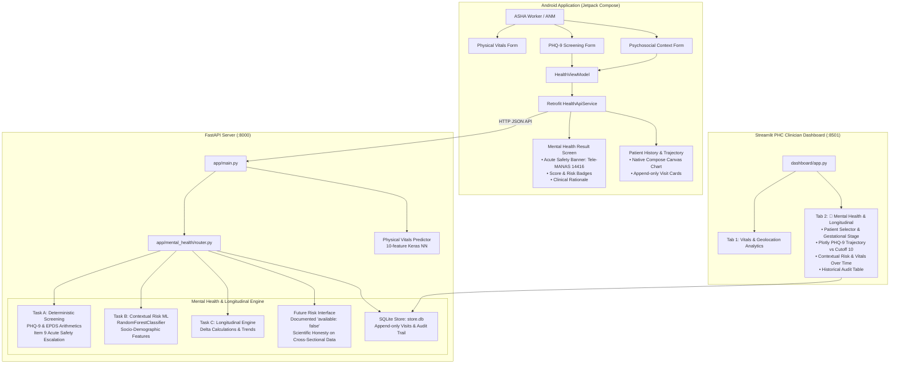

# 🩺 MatriAarogya: Maternal/Mental Health & Longitudinal Risk Assessment System

[](https://www.python.org/)
[](https://fastapi.tiangolo.com)
[](https://streamlit.io)
[](https://developer.android.com/jetpack/compose)
[]()

**MatriAarogya** is an open-source, AI-driven maternal healthcare ecosystem designed for **ASHA workers, ANMs, and PHC/CHC clinicians** in rural and semi-urban India. It combines **physical obstetrics risk classification** (hypertension, gestational diabetes, vital signs) with a comprehensive **maternal mental health and longitudinal trajectory tracking system** (PHQ-9 / EPDS screening, contextual psychosocial risk modeling, and visit-over-visit trajectory analytics).

---

## 🏛️ System Architecture



---

## 🧠 Core Mental Health & Longitudinal Modules

The system rigorously separates maternal mental health assessment into **three distinct clinical tasks**, avoiding data leakage and preserving clinical validity:

### Task A: Deterministic Clinical Screening (PHQ-9 & EPDS)
- **Arithmetic Integrity:** Standard clinical screening instruments (PHQ-9: 9 items, 0–3 points each, max score 27; EPDS: 10 items, 0–3 points each, max score 30) must be computed with deterministic summation. We do not use ML to predict or alter the questionnaire sum.
- **Clinical Severity Bands:**
  - `0 - 4`: Minimal / None
  - `5 - 9`: Mild depression
  - `10 - 14`: Moderate depression (At-Risk clinical cutoff: score $\ge 10$)
  - `15 - 19`: Moderately severe depression
  - `20 - 27`: Severe depression
- **🚨 Unconditional Safety Escalation:**
  If Item 9 of PHQ-9 (*"Thoughts that you would be better off dead, or of hurting yourself"*) is scored $> 0$, an **immediate acute safety flag** (`urgent_safety_flag: true`) is raised:
  - This alert is **independent** of whether the total PHQ-9 score is low or high.
  - This alert is **never suppressed** by a low ML risk estimate.
  - Triggers urgent escalation instructions directing clinicians to India's national mental health helpline: **Tele-MANAS (14416 / 1800 891 4416)**.

### Task B: Contextual Psychosocial Risk Estimation
- **Objective:** Estimate a pregnant woman's background vulnerability to depression based on socio-demographic and environmental stressors (family support, marital conflict, domestic violence, poverty/income, education, pregnancy intention).
- **Leakage Prevention:** To avoid circular reasoning and label leakage, **PHQ-9 questionnaire responses are strictly excluded** from the contextual ML feature vector.
- **Model:** Scikit-learn `RandomForestClassifier` trained on maternal health datasets, paired with a fitted `OneHotEncoder` and `StandardScaler`.
- **Explainability:** Returns calibrated probability, risk tier (`Low`, `Moderate`, `High`), and top contributing risk factors with non-causal statistical interpretations.

### Task C: Longitudinal Visit Tracking & Trajectory Analysis
- **Append-Only Store:** Every clinical encounter is permanently saved to an SQLite database (`store.db`). Prior visit records are immutable.
- **Trimester & Postpartum Logic:**
  - Weeks 1–13: First trimester
  - Weeks 14–27: Second trimester
  - Weeks 28–42+: Third trimester
  - Delivery Date recorded: Transitioned to Postpartum stage (weeks postpartum calculated dynamically).
- **Trajectory Metrics:**
  - Delta from previous visit: $\Delta \text{PHQ-9} = \text{Score}_t - \text{Score}_{t-1}$
  - Delta from baseline visit
  - Risk change: $\Delta \text{Risk} = \text{Risk}_t - \text{Risk}_{t-1}$
  - Trend classification: `improving` ($\Delta \le -3$), `worsening` ($\Delta \ge +3$), or `stable` ($|\Delta| < 3$).
  - Cumulative count of previous elevated screenings (Score $\ge 10$).

---

## 🔬 Scientific Honesty: Future Risk & Postpartum Prediction

> [!IMPORTANT]
> **Why `postpartum_prediction.available` is strictly `false`:**
> The available open research datasets (e.g., PERI_DEP Pakistan $\approx 14,000$ records, Dataset_1 Bangladesh $\approx 800$ records) are **cross-sectional surveys** captured at single discrete points in time.
> Cross-sectional datasets cannot measure true temporal latency or time-to-event outcomes across antepartum to postpartum transitions.
> Claiming that a model trained on cross-sectional data can "predict future postpartum depression months in advance" is **methodologically flawed and clinically dangerous** (can lead to false reassurance and missed interventions).
> 
> MatriAarogya exposes a formalized `FutureRiskModelInterface` (`app/mental_health/future_model.py`) that returns:
> ```json
> {
>   "available": false,
>   "model_name": "Longitudinal-Prospective-Ensemble",
>   "model_version": "0.0.0-unsupported",
>   "reason": "Prospective future postpartum depression prediction requires validated multi-wave longitudinal cohort data with antepartum-to-postpartum follow-up. Existing training data is cross-sectional; generating predictive claims without temporal follow-up data violates clinical safety guidelines.",
>   "minimum_data_requirements": [
>     "Prospective longitudinal cohort with >= 3 temporal anchor points (T1/T2, T3, and 6-week postpartum)",
>     "Standardized psychiatric diagnostic follow-up interview (e.g., SCID or MINI)",
>     "Time-to-event survival or hazard tracking"
>   ]
> }
> ```

---

## 📡 API Reference

### 1. Existing Physical Vitals
- `POST /predict`: Evaluates physical maternal risk using 10 features:
  - Age, SystolicBP, DiastolicBP, BS, BodyTemp, HeartRate, PreviousComplications, PreExistingDiabetes, GestationalDiabetes, MentalHealthHistory.
- `GET /`: Health check & API status.

### 2. Mental Health & Longitudinal Endpoints
Mounted at prefix `/mental-health`:

| Method | Endpoint | Description |
|---|---|---|
| `POST` | `/mental-health/patients` | Register a new patient (name, age, phone, state, gestational_age, delivery_date) |
| `GET` | `/mental-health/patients` | List registered patients |
| `GET` | `/mental-health/patients/{id}` | Retrieve patient profile by ID |
| `PUT` | `/mental-health/patients/{id}` | Update patient profile (e.g., set delivery date) |
| `POST` | `/mental-health/patients/{id}/visits` | Evaluate visit: compute PHQ-9, run context ML, compute longitudinal deltas, and save record |
| `GET` | `/mental-health/patients/{id}/history`| Retrieve chronological history of all visits and trajectories |
| `GET` | `/mental-health/patients/{id}/latest` | Retrieve latest visit evaluation |
| `POST` | `/mental-health/screening/score` | Standalone utility to score PHQ-9/EPDS without saving |
| `POST` | `/mental-health/context/predict` | Standalone utility to evaluate psychosocial context ML |

#### Example: Full Visit Evaluation Payload (`POST /mental-health/patients/{id}/visits`)
```json
{
  "visit_type": "prenatal",
  "gestational_age_weeks": 28,
  "screening": {
    "instrument": "phq9",
    "responses": {
      "item1": 2, "item2": 2, "item3": 1, "item4": 2,
      "item5": 1, "item6": 1, "item7": 1, "item8": 1, "item9": 1
    }
  },
  "context": {
    "age": 26,
    "education": "secondary",
    "household_income": "middle",
    "marital_status": "married",
    "family_support": "poor",
    "history_of_depression": "yes",
    "intimate_partner_violence": "sometimes",
    "unplanned_pregnancy": "yes"
  },
  "vitals": {
    "systolic_bp": 124,
    "diastolic_bp": 82,
    "heart_rate": 86,
    "blood_sugar": 5.4,
    "body_temperature": 98.4
  },
  "notes": "Patient reports sleep difficulty and marital stress."
}
```

#### Response Structure:
```json
{
  "visit_id": "8c3b4a2e-...",
  "patient_id": "p-101",
  "visit_number": 2,
  "visit_date": "2026-09-19T14:30:00Z",
  "current_screening": {
    "total_score": 12,
    "max_score": 27,
    "severity": "Moderate",
    "is_at_risk": true,
    "item9_score": 1,
    "acute_safety_flag": true,
    "safety_message": "CRITICAL: Suicidal ideation or self-harm thoughts detected. Immediate clinical escalation required. Contact Tele-MANAS (14416)."
  },
  "contextual_risk": {
    "risk_probability": 0.68,
    "risk_category": "High",
    "top_contributing_factors": [
      {"factor": "family_support_poor", "contribution": 0.28},
      {"factor": "history_of_depression_yes", "contribution": 0.22},
      {"factor": "intimate_partner_violence_sometimes", "contribution": 0.17}
    ],
    "explanation": "Contextual model estimates 68.0% probability of elevated psychosocial stress based on sociodemographic factors."
  },
  "longitudinal": {
    "previous_phq9_score": 7,
    "phq9_change": 5,
    "previous_risk_probability": 0.45,
    "risk_change": 0.23,
    "previous_elevated_screenings": 0,
    "trend": "worsening",
    "gestational_stage": "Third trimester"
  },
  "postpartum_prediction": {
    "available": false,
    "reason": "Prospective future postpartum depression prediction requires validated multi-wave longitudinal cohort data..."
  },
  "safety_flag": {
    "triggered": true,
    "reason": "Item 9 suicidal ideation / self-harm thoughts present.",
    "action": "Immediate clinical escalation. Call national mental health helpline Tele-MANAS (14416)."
  }
}
```

---

## 📱 Android Application (Jetpack Compose)

The mobile client is built with **Kotlin and Jetpack Compose**, tailored for frontline healthcare workers.

### Screen Flow:
1. **Profile / Navigation:** Direct entry to *"Mental Health Checkup"* or *"Patient Longitudinal History"*.
2. **PHQ-9 Screening Screen (`MentalHealthScreeningScreen.kt`):**
   - Renders 9 validated questions with interactive radio options (`0: Not at all` to `3: Nearly every day`).
   - Real-time running total score calculation.
   - Dynamic safety warning banner as soon as Item 9 $> 0$.
3. **Psychosocial Context Screen (`ContextualRiskScreen.kt`):**
   - Clean dropdown menus for family support, marital conflict, violence exposure, income, and education.
   - Pregnancy stage and postpartum toggle.
4. **Assessment Results Screen (`MentalHealthResultScreen.kt`):**
   - **Emergency Escalation Banner:** High-visibility red alert with direct call trigger to **Tele-MANAS (14416)** when safety flag is tripped.
   - Score badges, severity classification, and cutoff explanation.
   - ML risk gauge and top contributing factors.
   - Trajectory comparison against previous visit.
   - Scientific honesty disclosure regarding prospective prediction.
5. **Longitudinal History Screen (`PatientHistoryScreen.kt`):**
   - Complete visit timeline cards.
   - **Native Compose Canvas Trajectory Chart:** Renders historical PHQ-9 trajectory, clinical cutoff line at score 10, and highlighted acute safety markers.

---

## 🖥️ Streamlit Clinician Dashboard

The web dashboard (`dashboard/app.py`) provides an interactive interface for PHC/CHC medical officers:
- **Tab 1: Physical Vitals & Geolocation:** Map of high-risk cases across PHC blocks, daily checkup stats, and complaints tracking.
- **Tab 2: 🧠 Mental Health & Longitudinal Monitoring:**
  - Real-time patient selection with gestational stage & postpartum badge.
  - KPI metric cards: Total PHQ-9, Severity, Risk Status, Contextual Probability, Trajectory Trend, Visit Count.
  - **Interactive Plotly Visualizations:**
    1. *PHQ-9 Trajectory over Visits:* Plots historical scores against clinical threshold 10 with red alert markers for visits with self-harm ideation.
    2. *Contextual ML Risk Progression (%):* Plots background vulnerability over time.
    3. *Physical Vitals (Systolic BP & Heart Rate):* Monitored alongside mental health to detect hypertensive spikes during acute distress.
  - Longitudinal Audit Table: Chronological, read-only visit log.

---

## 🧪 Testing & Verification

The test suite validates both existing physical risk models and the new mental health & longitudinal engine:

```bash
# Run pytest with full verbosity
python -m pytest tests/ -v
```

### Test Suite Structure:
- `tests/test_existing_predict_regression.py`: Verifies `/predict` endpoint, Keras neural network inference, and root route.
- `tests/test_mental_health.py`: Verifies PHQ-9 deterministic summation, clinical cutoff 10, severity bands, Item 9 safety flag isolation, EPDS scoring, trimester boundary math, and longitudinal trend categorization.
- `tests/test_end_to_end_workflow.py`: Validates end-to-end patient lifecycle (registration, multi-visit prenatal to postpartum progression, longitudinal delta persistence, safety flag priority, and error handling).

**Test Results:** `32 passed, 0 failures in 17.42s`.

---

## 🚀 Quick Start Guide

### 1. Environment Setup
```bash
# Clone the repository
git clone https://github.com/sys6-exe/MatriAarogya.git
cd "MatriAarogya part2"

# Install Python dependencies
pip install fastapi uvicorn pydantic scikit-learn tensorflow pandas numpy streamlit plotly requests pytest
```

### 2. Launch FastAPI Server
```bash
uvicorn app.main:app --host 0.0.0.0 --port 8000 --reload
# API Docs available at: http://localhost:8000/docs
```

### 3. Launch Streamlit PHC Dashboard
```bash
streamlit run dashboard/app.py
# Dashboard accessible at: http://localhost:8501
```

### 4. Build & Run Android App
1. Open `C:\Users\Akansha Srivastava\AndroidStudioProjects\SanRakshaApp` (or `AndroidApp/MatriAarogya`) in **Android Studio Ladybug / Meerkat**.
2. Sync Gradle files.
3. Update `BASE_URL` in `healthApiService.kt` if running on an emulator (`http://10.0.2.2:8000/`) or physical phone (`http://<YOUR_IP>:8000/`).
4. Run on Android device or emulator.
